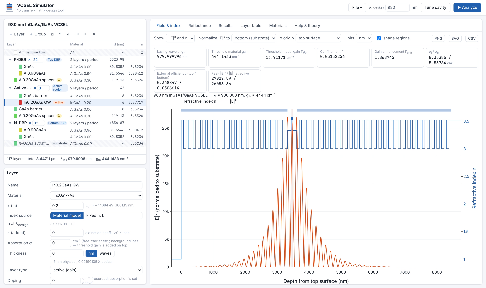

# VCSEL Simulator

A browser-based design tool for vertical-cavity surface-emitting lasers (VCSELs), built as a modern
replacement for the old *Vertical* program. Build a layer stack, and it computes the threshold gain,
the standing-wave field, the gain and loss budget, and the mirror reflectance.

**Use it online:** https://dfeezell.github.io/vcsel-sim/ (nothing to install; the first load takes about 10 s
while the Python engine downloads into the browser).



## What it does (phase 1, 1D)

- **Stack builder.** Layers from the exit medium (top) to the substrate, with nested groups that repeat
  *N* times, so DBR pairs and quantum wells are a single number to change. Thickness in nm or in waves
  (optical thickness at the design wavelength).
- **Materials with references.** AlGaAs, InGaAs, InGaAsP, InAlGaAs, InP, GaN, AlN, AlGaN, InGaN, SiO₂, Si₃N₄, Ta₂O₅, TiO₂, HfO₂,
  Nb₂O₅, Al₂O₃, AlOx, metals (Au, Ag, Ti, Cr, Pt), or a fixed n + ik. The *Materials* tab plots each model and lists its source.
- **Threshold.** Lasing wavelength and threshold material gain, solved exactly (outgoing waves only).
- **Gain and loss budget.** Round-trip gain, internal loss, and transmission through the top and bottom; gain enhancement
  factor; confinement factor; modal gain; α<sub>i</sub>, α<sub>m</sub>; mirror reflectances; external efficiency and
  slope efficiency; photon lifetime.
- **Course-notes cavity model.** DBR penetration depths (Coldren & Corzine A7.25, with the Ch. 3 approximations and a
  reflection-phase check), cavity length L = L<sub>cav</sub> + L<sub>eff,1</sub> + L<sub>eff,2</sub>, confinement factor Γ = Γ<sub>enh</sub>L<sub>a</sub>/L,
  R<sub>up</sub>/R<sub>down</sub>, and the cavity optical thickness.
- **DBR design tab.** Design a quarter-wave mirror on its own: spectrum, R (numeric and analytic), stopband, penetration depth,
  pairs needed for a target R. Insert it into the stack with one click.
- **Field plot.** |E|² and refractive index versus depth, normalized to the substrate, the top, or the peak.
- **Mirror reflectance.** The passive (as-grown) spectrum of each DBR seen from the cavity, or of the whole wafer, as
  R, phase, 1 − R or T. There is no artificial spike at the lasing wavelength.
- **Cavity tuning.** Tick *Marked* on the spacer layers and press *Tune cavity* to put the resonance on the design wavelength.
- **Files.** Save and open designs (`.vcsel.json`), open old Vertical `.vrt` files, export any plot as PNG or SVG and any
  result as CSV.

## Agreement with Vertical

For the ECE 577 final-project structure, read directly from its `.vrt` file:

| Quantity | Vertical | This tool |
|---|---|---|
| Threshold gain (cm⁻¹) | 2111.42 | 2111.42 |
| Lasing wavelength (nm) | 980.000 | 980.000 |
| RT transmission | 0.00626751 | 0.00626728 |
| RT internal loss | 0.00205118 | 0.00205415 |
| Gain enhancement | 1.96992 | 1.97058 |
| Peak \|E\|² | 1242.53 | 1241.88 |
| External efficiency | 0.753425 | 0.753149 |

The *Results* tab shows a "Vertical convention" column next to the exact values. See *Help & theory* in the app for the
differences between the two, and `tests/` for the checks.

## Using the engine from Python

The engine is plain Python and needs only numpy.

```bash
pip install -e .
```

```python
from vcsel_sim.vrt import read_vrt
from vcsel_sim.structure import Structure
from vcsel_sim.laser import analyze, reflectance_spectrum
import json

s = read_vrt(open("examples/ECE577_Final_Project_DF.vrt", "rb").read())
# or: s = Structure.from_dict(json.load(open("examples/gaas_980nm_vcsel.vcsel.json")))
a = analyze(s)
print(a.wavelength, a.threshold_gain, a.enhancement, a.confinement)

spec = reflectance_spectrum(s, 900, 1060, 1001, part="bottom_dbr")   # passive mirror seen from the cavity
```

Run the tests with `pip install pytest` then `pytest`.

## Repository layout

| Path | Contents |
|---|---|
| `vcsel_sim/` | Python engine: `structure` (layers and groups), `materials`, `tmm` (transfer matrices), `laser` (threshold, field, budget, reflectance, tuning), `vrt` (Vertical file reader), `export` (CSV), `templates`, `api` (JSON functions used by the web page) |
| `index.html`, `web/` | The browser interface. It loads the Python engine with [Pyodide](https://pyodide.org) and plots with [Plotly](https://plotly.com/javascript/). |
| `examples/` | Example designs, including the ECE 577 `.vrt` file |
| `tests/` | Validation against Vertical and physics checks |

## Planned

- Phase 2: oxide and air apertures, lateral modes, diffraction and scattering loss, 2D modal gain.
- User-defined gain spectra g(λ, N).
- AlGaInP and InAlGaAs material models.

## License

MIT. See `LICENSE`.

## Releasing changes

The page loads `web/app.js`, `web/about.js` and `web/app.css` with a `?v=` version tag in `index.html`. Bump that tag whenever
those files change, so browsers don't mix a cached old script with new Python files. GitHub Pages caches pages for up to
10 minutes, so a refresh may be needed right after an update.
